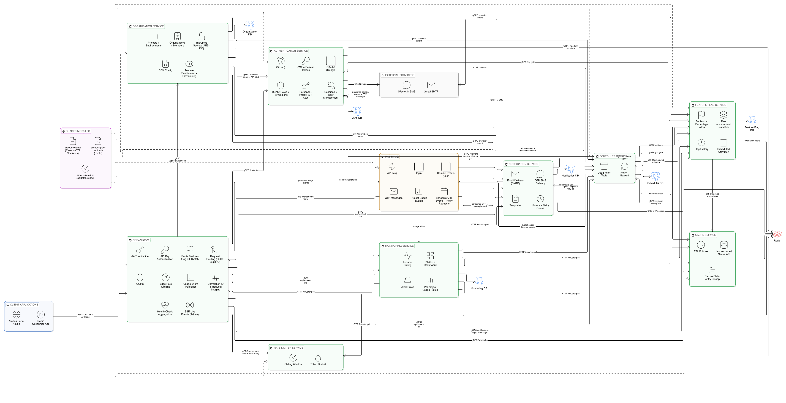

# Arceus Platform

A multi-tenant **Backend-as-a-Service** platform: nine independently deployable Spring Boot
microservices behind a single API Gateway, plus a Next.js portal for operating the platform and
managing tenant projects.

Developers sign up, create an **Organization → Project → Environment**, switch on the backend
modules they need (authentication, notifications, cache, scheduler, feature flags), and call them
with a project API key. Platform operators get a full admin console on top.



> Architecture diagram: [`docs/images/architecture.png`](docs/images/architecture.png)
> (source: [`docs/architecture.eraser`](docs/architecture.eraser))

---

## Highlights

- **Gateway-first.** Clients only ever talk to `gateway-service`. It verifies JWTs / API keys,
  applies per-route feature-flag kill switches and a rate limit, then forwards the request to the
  owning service over gRPC.
- **REST at the edge, gRPC inside.** Browsers and SDKs get plain REST/JSON; services talk to each
  other over strongly typed gRPC.
- **Event-driven.** Domain events (user registered, API key created, job failed, flag changed, …)
  flow over RabbitMQ and power notifications, the live activity feed, and usage tracking.
- **Multi-tenant.** Organizations → Projects → Environments, per-project API keys, AES-256
  encrypted secrets, and per-environment module enablement.
- **Database per service.** Each stateful service owns its own Postgres database.
- **Secure by default.** Email OTP 2FA on login, refresh-token rotation, RBAC with editable
  roles/permissions, Google/GitHub OAuth2, and internal-token auth between services.

## Architecture

The diagram above shows three kinds of communication:

| Style | Used for |
|---|---|
| **REST** | Clients to the Gateway only |
| **gRPC** | Synchronous calls from the Gateway to services, and between services |
| **RabbitMQ** | Asynchronous events |

A fourth, plain **HTTP**, is used for Actuator polling by monitoring-service and for
scheduler-service callbacks. Shared libraries (`arceus-events`, `arceus-grpc-contracts`,
`arceus-ratelimit`) are compiled into every service and are not services themselves.

### 1. Request flow

1. A client (the portal, a third-party app or SDK, the demo app) calls the Gateway over REST with
   either a JWT (`Authorization: Bearer`) or a project API key (`X-API-Key`).
2. The Gateway runs its filter chain: CORS → request ID → request logging → API-key auth → JWT
   auth → route feature-flag check → rate limit.
3. It forwards the request to the owning service over gRPC. The service replays it into its own
   REST controller, so each controller stays the single source of truth for that service.
4. The Gateway asks `ratelimit-service` for a decision on every protected request, over gRPC. If
   that service is unreachable the request is allowed through (fail open).

### 2. Asynchronous events (RabbitMQ)

| Publisher | Events | Consumer |
|---|---|---|
| auth-service | Domain events (user registered, login success/failure, password/email/phone changed, API key created/revoked) | notification-service (welcome email on `user.registered`) and the Gateway's live-event stream |
| auth-service | OTP messages | notification-service delivers them by email / SMS |
| scheduler-service | Job lifecycle events (`job.scheduled`, `started`, `completed`, `failed`, `cancelled`, `expired`) | Gateway live-event stream |
| any service / API | Retry requests and delayed-execution nudges | scheduler-service |
| gateway-service | Per-project usage events | monitoring-service (usage rollup) |

The Gateway also consumes the event exchange and streams it to admins over SSE at
`/api/live/events`, which feeds the portal's Live Activity card.

### 3. Module provisioning

When a project enables a module, `organization-service` calls the owning service's
`ProvisionTenant` / `DeprovisionTenant` gRPC endpoint (and auth-service's API-key provisioning
endpoint) and records `ACTIVE` or `FAILED` in the same request.

| Module | Provisioned by |
|---|---|
| `AUTHENTICATION` | auth-service |
| `NOTIFICATION` | notification-service |
| `CACHE` | cache-service |
| `SCHEDULER` | scheduler-service |
| `FEATURE_FLAGS` | feature-flag-service |

### 4. Scheduled background work

`scheduler-service` is the one place that owns "when does this run and what happens if it fails".
Other services register jobs with it over gRPC, and it calls them back over HTTP when a job is due,
presenting a shared internal token.

| Registered by | Job |
|---|---|
| auth-service | Expired-session cleanup |
| cache-service | Stale-entry sweep |
| notification-service | Retry of failed notifications |
| feature-flag-service | Scheduled flag activation / deactivation |

A job's work never runs inside scheduler-service. It either POSTs to the owner's callback URL or
publishes a RabbitMQ message. Failed jobs are retried with backoff, then written to a dead-letter
table.

### 5. Feature-flag gating

`feature-flag-service` is both a product feature for tenants and a platform control:

- **Gateway:** per-route kill switch, evaluated before the request is forwarded.
- **auth-service, notification-service, scheduler-service:** gate their own features through flags
  (for example, notification channels).
- **Caching:** flag evaluations are cached in Redis (default 60 s) so gating adds little latency.

### 6. Monitoring and usage

`monitoring-service` polls every other service's Actuator endpoints over HTTP on an interval, builds
the platform health dashboard, evaluates alert rules, and rolls up per-project usage from the
Gateway's usage events.

### 7. Data stores

| Store | Owner(s) | Holds |
|---|---|---|
| Postgres `arceus_auth` | auth-service | Users, roles, permissions, refresh tokens, API keys |
| Postgres `arceus_organization` | organization-service | Organizations, projects, environments, secrets, modules |
| Postgres `arceus_notification` | notification-service | Templates, notification records |
| Postgres `arceus_scheduler` | scheduler-service | Jobs, execution history, dead letters |
| Postgres `arceus_feature_flag` | feature-flag-service | Flags, history |
| Postgres `arceus_monitoring` | monitoring-service | Alert rules, metrics, usage |
| Redis (shared) | auth, notification, ratelimit, cache, feature-flag, monitoring | OTP codes and SMS sessions, rate-limit counters, cache entries, flag evaluation cache |

Services never read each other's databases. They share Redis only for the keys defined in
`arceus-events`.

### 8. External providers

| Provider | Used by | For |
|---|---|---|
| Gmail SMTP | notification-service | Email delivery |
| 2Factor.in | notification-service | OTP SMS delivery |
| Google / GitHub OAuth2 | auth-service | Social login |

## Services

| Service | REST | gRPC | Responsibility |
|---|---|---|---|
| `gateway-service` | 8090 | – | Single entry point. JWT + API-key auth, route flags, rate limiting, request IDs, CORS, SSE live events, health. |
| `auth-service` | 8081 | 9081 | Registration, login with email/SMS OTP, JWT + refresh tokens, OAuth2 (Google/GitHub), RBAC, sessions, user and API-key management. |
| `notification-service` | 8082 | 9082 | Email (SMTP) and OTP SMS (2Factor.in) delivery, templates, history, retry queue. |
| `ratelimit-service` | 8084 | 9084 | Standalone sliding-window / token-bucket limiter backed by Redis. |
| `cache-service` | 8085 | 9085 | Namespaced Redis cache API (strings, hashes, lists, sets, sorted sets) with TTL policies and stats. |
| `scheduler-service` | 8086 | 9086 | One-off, delayed, cron and fixed-rate jobs with retries and a dead-letter table. |
| `feature-flag-service` | 8087 | 9087 | Boolean / percentage-rollout flags, per-environment, Redis-cached, scheduled activation. |
| `monitoring-service` | 8088 | 9088 | Polls every service's Actuator endpoints, platform dashboard, alert rules, per-project usage. |
| `organization-service` | 8091 | 9090 | Organizations, members, projects, environments, secrets, module enablement, SDK config. |

Shared libraries (`shared/`):

| Library | Purpose |
|---|---|
| `arceus-events` | RabbitMQ topology and event/message contracts shared by publishers and consumers. |
| `arceus-grpc-contracts` | The `.proto` files every gRPC client and server is generated from. |
| `arceus-ratelimit` | The in-process `@RateLimited` annotation and Redis limiter used by individual services. |

### Gateway routes

| Client path | Downstream service |
|---|---|
| `/api/auth/**` | auth-service |
| `/api/organizations/**` | organization-service |
| `/api/notifications/**` | notification-service |
| `/api/cache/**` | cache-service |
| `/api/scheduler/**` | scheduler-service |
| `/api/feature-flags/**` | feature-flag-service |
| `/api/monitoring/**` | monitoring-service |
| `/api/live/events` | Gateway itself (admin-only SSE stream) |
| `/health` | Gateway itself (reports downstream status) |

`ratelimit-service` is internal-only and has no public route.

## Tech stack

Java 21 · Spring Boot 3.5 · Spring Security · Spring Data JPA · gRPC (`net.devh` starter) ·
PostgreSQL 16 · Redis 7 · RabbitMQ 3.13 · Maven (multi-module) · Next.js 15 · React 19 ·
TypeScript · Tailwind CSS · TanStack Query · Docker Compose

---

## Quick start (Docker)

Requires Docker with Compose v2.

```bash
git clone <this-repo>
cd arceus-platform
docker compose up --build
```

The first build compiles every service from source, so allow a few minutes.

| What | URL |
|---|---|
| Portal | http://localhost:3000 |
| Gateway health | http://localhost:8090/health |
| RabbitMQ management | http://localhost:15672 (`guest` / `guest`) |
| Swagger UI (per service) | `http://localhost:<port>/swagger-ui.html` |

### Signing in

Compose bootstraps a super-admin on first start:

| Email | Password |
|---|---|
| `admin@arceus.local` | `ChangeMe123!` |

Login is two-step: password, then a 6-digit code sent by email. The compose file ships dummy SMTP
credentials, so **no email is actually delivered**. For a local demo, read the code straight from
Redis:

```bash
docker compose exec redis redis-cli GET "otp:email:LOGIN_2FA:admin@arceus.local"
```

To receive real emails and SMS instead, set real `GMAIL_USERNAME`, `GMAIL_APP_PASSWORD` and
`TWOFACTOR_API_KEY` values for `auth-service` and `notification-service` in `docker-compose.yml`.

> All secrets in `docker-compose.yml` are demo values. Replace every one of them before running
> anywhere other than your own machine.

## Running without Docker

You need Java 21, Node 20+, and running Postgres, Redis and RabbitMQ instances.

```bash
cp .env.example .env        # fill in connection details and secrets
./scripts/run-all.sh        # macOS / Linux
scripts\run-all.cmd         # Windows
```

The script builds all modules, then starts the nine services (scheduler first, monitoring last).
Outside Docker you must create the Postgres databases yourself: one per service
(`arceus_auth`, `arceus_notification`, `arceus_scheduler`, `arceus_feature_flag`,
`arceus_organization`, `arceus_monitoring`). You can reuse
[`infra/postgres/init-databases.sh`](infra/postgres/init-databases.sh) for that.

Start the portal separately:

```bash
cd portal
npm install
cp .env.local.example .env.local
npm run dev                 # http://localhost:3000
```

Set `GATEWAY_CORS_ALLOWED_ORIGINS=http://localhost:3000` (and any other origin you serve from) on
the Gateway, otherwise the browser will block requests.

To run a single service, install the modules once, then start it:

```bash
./mvnw -q install -DskipTests
./mvnw -pl services/auth-service spring-boot:run
```

## Tests

```bash
./mvnw test
```

Unit tests cover the scheduler (retry policy, triggers, validation), feature flags (rollout
evaluation, value codec, validation), cache (TTL, namespaces) and monitoring (alert evaluation,
metric parsing). The `contextLoads` tests in `auth-service` and `gateway-service` need live
Postgres/Redis/RabbitMQ.

## Configuration

Every setting is an environment variable, listed with defaults and comments in
[`.env.example`](.env.example). The main groups:

| Group | Examples |
|---|---|
| Infrastructure | `DB_*`, `REDIS_*`, `RABBITMQ_*` |
| Auth | `JWT_SECRET`, `SUPER_ADMIN_EMAIL`, `SUPER_ADMIN_PASSWORD`, `AUTH_API_KEY_ENCRYPTION_KEY`, OAuth client IDs |
| Delivery | `GMAIL_USERNAME`, `GMAIL_APP_PASSWORD`, `TWOFACTOR_API_KEY` |
| Gateway | `GATEWAY_PORT`, `GATEWAY_RATE_LIMIT`, `GATEWAY_RATE_LIMIT_WINDOW_SECONDS`, `GATEWAY_CORS_ALLOWED_ORIGINS` |
| gRPC wiring | `*_GRPC_HOST`, `*_GRPC_PORT` |
| Internal auth | `*_INTERNAL_API_TOKEN` (shared secret between a service and its callers) |
| Organization | `ORGANIZATION_SECRETS_KEK` (key-encryption key for project secrets) |

`JWT_SECRET` must be identical for `auth-service` (signs) and `gateway-service` (verifies).

## Project layout

```
services/
  gateway-service/       auth-service/         organization-service/
  notification-service/  cache-service/        scheduler-service/
  feature-flag-service/  monitoring-service/   ratelimit-service/
shared/
  arceus-events/         arceus-grpc-contracts/  arceus-ratelimit/
portal/                  Next.js portal (operator console + developer workspace)
demo/                    Static consumer app that uses a project API key
infra/postgres/          Creates one database per service on first start
scripts/                 run-all.sh / run-all.cmd
docs/                    architecture.eraser + images/architecture.png
docker-compose.yml       One-command local stack
```

Each service is a standard Maven module with its own `pom.xml`, `application.yml` and
`Dockerfile`, and can be built and run on its own or through the root reactor `pom.xml`.

## Documentation

| Doc | Covers |
|---|---|
| [`docs/architecture.eraser`](docs/architecture.eraser) | Diagram-as-code source for the architecture PNG (paste into eraser.io) |
| [`portal/README.md`](portal/README.md) | Portal pages, role-based access, auth flow, live updates |
| [`demo/README.md`](demo/README.md) | Using the platform from a third-party app with an API key |
| [`services/gateway-service`](services/gateway-service/README.md) | Request pipeline, routing, public routes |
| [`services/auth-service`](services/auth-service/README.md) | Endpoints, OTP login, API keys, RBAC |
| [`services/notification-service`](services/notification-service/README.md) | Delivery paths, templates, retries |
| [`services/ratelimit-service`](services/ratelimit-service/README.md) | `POST /check`, algorithms |
| [`services/cache-service`](services/cache-service/README.md) | REST/gRPC API, TTL policies, namespaces |
| [`services/scheduler-service`](services/scheduler-service/README.md) | Job lifecycle, triggers, retry and dead-letter |
| [`shared/arceus-events`](shared/arceus-events/README.md) | Event and message contracts |
| [`shared/arceus-ratelimit`](shared/arceus-ratelimit/README.md) | `@RateLimited` annotation |

## Known limitations

- **Project secrets are stored but not yet delivered.** `SecretService.resolvePlaintext` exists, but
  nothing hands decrypted secrets to other services at runtime.
- **No GitHub repo linking or auto-deploy.** `ProjectEnvironment.trackedBranch` is informational only.
- **Project API keys inherit their creator's roles.** Fine for a demo; a production multi-tenant
  setup should scope a key to its own project's data.
- **Email only on the generic notification API.** `POST /notifications` sends email; SMS is used
  for OTP delivery only. Failed messages stay `FAILED` after the retry limit (no dead-letter queue).
- **Schema is auto-managed.** Services use Hibernate `ddl-auto: update`; move to Flyway or
  Liquibase migrations before a production release.
- **Rate limiting fails open.** If `ratelimit-service` is unreachable the Gateway lets the request
  through, and each service's local `@RateLimited` rules act as the backstop.